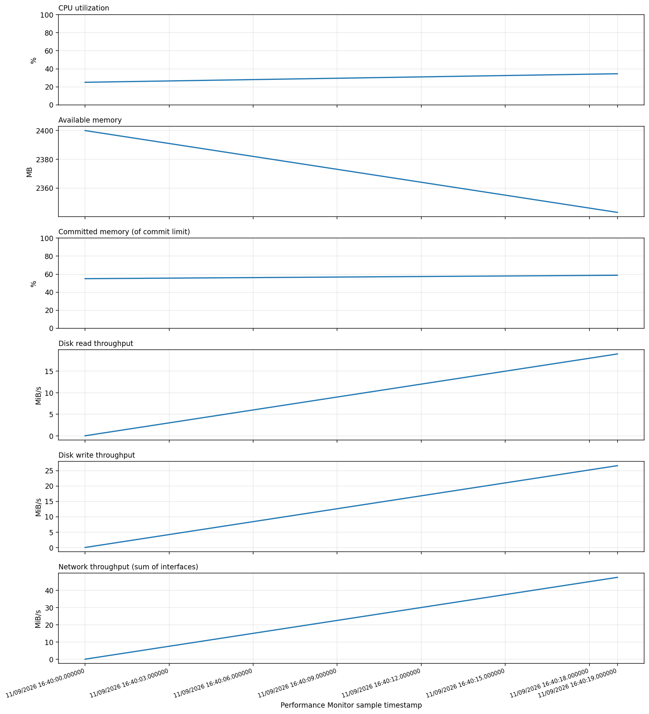

# Windows Performance Monitor Reporting with Python

Automate **Windows Performance Monitor (PerfMon / MMC 3.0)** reports using native Windows performance counters. Collect live measurements or analyze existing `.blg` / `.csv` logs, then generate an HTML dashboard, trend charts, and clean CSV data.

> **Platform:** Live collection (`typeperf`) and `.blg` conversion (`relog`) require Windows. Analyzing an existing PerfMon CSV and generating reports works on Windows, macOS, and Linux.

## Features

- CPU utilization, available memory, committed memory, disk read/write throughput, and total network-interface throughput.
- Native PerfMon collection with Microsoft's `typeperf` utility; no administrator privilege is needed for every counter on every machine, but permissions can vary.
- Import existing `.blg` logs with `relog`, or read existing PerfMon `.csv` exports.
- HTML report with averages, peaks, latest readings, and a PNG chart.
- A normalized CSV for further analysis in Excel or Python.
- Timestamped report folders (previous results are not overwritten).
- GitHub Actions CI and offline tests using simulated data.
- Ready to run regularly with Windows Task Scheduler.

## Preview



*Sample chart based on simulated data. This repository does not contain real device performance logs.*

## Requirements

- **Python 3.10+** (3.12 recommended).
- **Windows 10/11 or Windows Server** for live collection or reading `.blg` files.
- `matplotlib` from `requirements.txt`.
- `typeperf.exe` and `relog.exe`, usually already supplied with Windows.

The code has been tested with a synthetic CSV on Linux; actual Windows counter availability and `.blg` handling should be verified on your target Windows host.

## Quick start (Windows PowerShell)

```powershell
# From the project root, after downloading/unzipping or cloning:
cd C:\path\to\perfmon-python-report
py -3 -m venv .venv
.\.venv\Scripts\Activate.ps1
python -m pip install --upgrade pip
python -m pip install -r requirements.txt

# Collect 12 samples, 5 seconds apart (~1 minute):
python perfmon_report.py --interval 5 --samples 12
```

If PowerShell blocks virtual environment activation, use the environment's `python.exe` directly instead:

```powershell
.\.venv\Scripts\python.exe -m pip install -r requirements.txt
.\.venv\Scripts\python.exe perfmon_report.py --interval 5 --samples 12
```

## Other ways to run

### Existing PerfMon CSV (also works on Linux/macOS)

```powershell
python perfmon_report.py --csv examples/sample_perfmon.csv
```

### Existing Performance Monitor binary `.blg` log (Windows only)

```powershell
python perfmon_report.py --blg "C:\PerfLogs\Admin\MyCollector\DataCollector01.blg"
```

### A longer live collection

```powershell
# 60 samples, 10 seconds apart (~10 minutes):
python perfmon_report.py --interval 10 --samples 60
```

### Choose an output directory

```powershell
python perfmon_report.py --csv examples/sample_perfmon.csv --output "C:\PerfMonReports"
```

### Display command options

```powershell
python perfmon_report.py --help
```

> Default counters are defined in the `COUNTERS` list in `perfmon_report.py`. If your Windows installation uses localized names or omits some counters, check available paths using `typeperf -qx` in PowerShell and update the list. Custom CSV/BLG files must contain at least one recognized counter in the `METRICS` list.

## Output structure

Each execution creates a unique dated directory:

```text
reports/
└── 20261110_103000_123456/
    ├── report.html               # Open in a browser
    ├── performance_charts.png    # Trend visualization
    ├── performance_data.csv      # Clean, normalized metric data
    └── raw_perfmon.csv           # Raw/imported Performance Monitor samples
```

### Metrics and units

| Report metric | PerfMon counter | Output unit |
| --- | --- | --- |
| CPU utilization | `\Processor(_Total)\% Processor Time` | % |
| Available memory | `\Memory\Available MBytes` | MB |
| Committed memory (of commit limit) | `\Memory\% Committed Bytes In Use` | % |
| Disk read throughput | `\PhysicalDisk(_Total)\Disk Read Bytes/sec` | MiB/s |
| Disk write throughput | `\PhysicalDisk(_Total)\Disk Write Bytes/sec` | MiB/s |
| Network throughput | `\Network Interface(*)\Bytes Total/sec` | MiB/s |

**Interpretation:** Committed memory is *not* physical RAM usage. Network totals sum matched NIC instances and may include VPN or virtual adapters; these are not necessarily equivalent to unique physical network traffic. Disk throughput is not disk utilization percentage.

## Automate with Windows Task Scheduler

1. Copy the repository to a permanent directory, such as `C:\PerfMonPython`.
2. Make sure `py -3` works in the account that will execute the task. Install dependencies for that Python installation, or edit `scripts\run_report.cmd` to use an absolute path to your virtual environment's `python.exe`.
3. Press **Win + R**, type `taskschd.msc`, and open **Task Scheduler**.
4. Choose **Create Task** and enter `PerfMon Python Report`.
5. On **Triggers**, create a new daily trigger and set **Repeat task every: 1 hour** and **for a duration of: Indefinitely** (if that option is available).
6. On **Actions**, choose **Start a program** and select `C:\PerfMonPython\scripts\run_report.cmd` (adjust if necessary).
7. On **Settings**, choose the overlap policy you want; for hourly, one-minute executions, **Do not start a new instance** is usually appropriate.
8. Save, right-click the task, and choose **Run** to validate it. Check **Last Run Result** and the `reports` folder.

**Sampling clarification:** Running the provided batch file each hour creates a **short snapshot each hour**, not continuous coverage. For actual 24/7 logging, configure a **Performance Monitor Data Collector Set** to log continuously and run `--blg` for completed log segments. The scheduler itself does not keep counters recording between executions.

## Running tests

Tests use the Python standard library, so no additional testing packages are required:

```powershell
python -m unittest discover -s tests -v
```

Generate a demo report from bundled simulated CSV data:

```powershell
python perfmon_report.py --csv examples/sample_perfmon.csv
```

The GitHub Actions workflow runs tests and a demo smoke test on Windows and Ubuntu for multiple supported Python versions.

## Repository layout

```text
perfmon-python-report/
├── .github/workflows/ci.yml
├── .gitignore
├── LICENSE
├── README.md
├── requirements.txt
├── perfmon_report.py
├── docs/example-chart.png
├── examples/sample_perfmon.csv
├── scripts/run_report.cmd
└── tests/test_perfmon_report.py
```

## Troubleshooting

| Problem | What to check |
| --- | --- |
| `'typeperf' is not recognized` | Run on Windows, and ensure `C:\Windows\System32` is accessible. |
| `No recognized counters` | Check the `.csv` header, OS language, and metric suffixes in `METRICS`. |
| `Access denied` for a counter | Confirm account permissions or try an elevated PowerShell session. |
| Task works manually but not in scheduler | Validate the task's user account, Python path, working directory, and dependencies. |
| Unable to open HTML chart | Keep `report.html` and `performance_charts.png` in the same output directory. |
| `.blg` import fails | Test the Windows command `relog "path\file.blg" /f CSV /o "path\out.csv" /y`. |

## Privacy and security

- `reports/` and all `*.blg` files are excluded by `.gitignore` to reduce the risk of accidentally publishing real computer names, resource usage, or system information.
- The example CSV is **simulated** and intended for tests and screenshots only.
- Review output paths and log data before publishing or sharing generated reports.
- Running the reporting tool does not require network access or external APIs.

## License

Licensed under the [MIT License](LICENSE). You may change the license before publishing your own repository.
